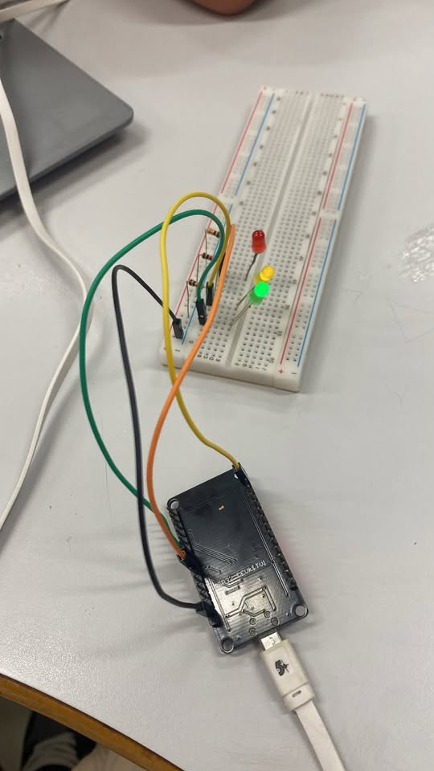

# 🚦 Experimento: Semáforo

## 📌 Sobre o projeto

Este projeto consiste na criação de um semáforo utilizando três LEDs de cores diferentes, controlados por um microcontrolador ESP32. O objetivo do experimento é demonstrar, de forma prática, como funciona a sequência de sinalização de um semáforo de trânsito.

O projeto foi realizado por **Heloá V. de Oliveira, Lívia M. Guarizo, Vinícius Godoi, Kauã Lúcio**, com o intuito de aplicar conhecimentos de eletrônica e programação.

## 🧰 Materiais utilizados

- 1 LED verde
- 1 LED amarelo
- 1 LED vermelho
- 3 resistores
- 1 microcontrolador ESP32
- 1 protoboard
- 4 jumpers 

## ⚙️ Como foi realizado

Inicialmente, montamos o circuito na protoboard, conectando os três LEDs aos pinos do ESP32 por meio de resistores e jumpers. Depois, desenvolvemos um código para controlar o acendimento e o apagamento dos LEDs em uma sequência programada.

A programação foi elaborada para simular o funcionamento de um semáforo real, alternando entre as luzes verde, amarela e vermelha, cada uma representando uma etapa da sinalização do trânsito.

## 💻 Programação

O código foi desenvolvido para o ESP32, definindo os pinos de cada LED e os intervalos de tempo entre as mudanças de cores. Dessa forma, o microcontrolador controla automaticamente a sequência de iluminação.

## 📸 Registro do experimento

Confira abaixo as fotos do circuito montado e em funcionamento, mostrando o resultado do nosso experimento!

## Demonstração do projeto

- > Click no link abaixo e assita a demonstração do Arduíno 

https://youtube.com/shorts/tdd-hNvWxTk?feature=share

## ✅ Conclusão

Com a realização deste projeto, conseguimos compreender melhor como funciona o controle de componentes eletrônicos por meio da programação. Além disso, aprendemos a utilizar o ESP32, a protoboard, os resistores e os LEDs para construir uma simulação simples de um semáforo de trânsito.
